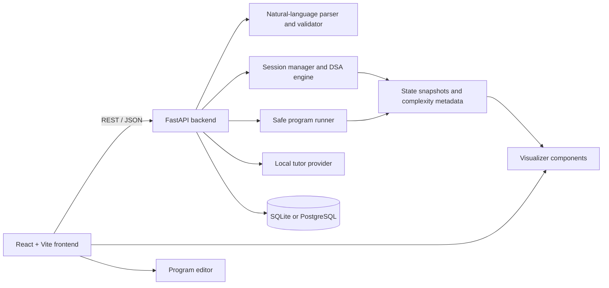
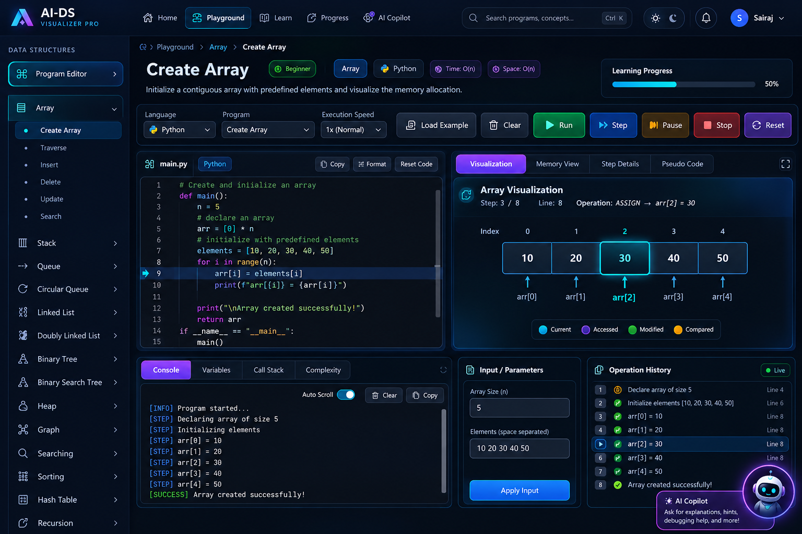
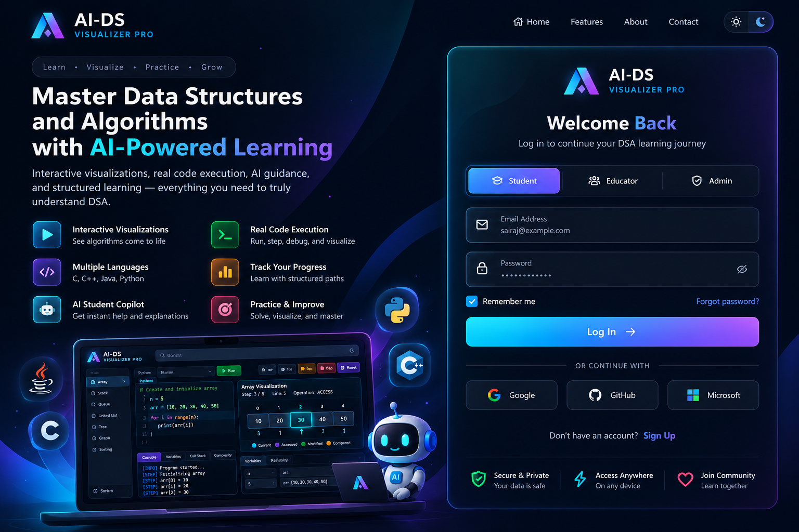

# AI-DS Visualizer Pro

AI-DS Visualizer Pro is an interactive Data Structures and Algorithms learning platform with step-by-step visualizations, executable programs, progress tracking, and an AI-assisted tutor.

[](https://ai-ds-visualizer-pro.vercel.app/)
[](frontend/)
[](backend/)
[](#license)

## Why this project exists

DSA is easier to learn when the learner can see the state of a data structure change while an operation executes. AI-DS Visualizer Pro connects code, execution events, complexity metadata, visual state, and learning progress in one workspace.

## Features

- Interactive visualizers for arrays, stacks, queues, linked lists, trees, heaps, graphs, searching, sorting, hash tables, and recursion.
- Step navigation through execution events, state snapshots, and complexity information.
- Program execution for Python, C, C++, and Java.
- Safe code-to-visualization recognition for supported educational patterns.
- Natural-language commands for supported data structures and operations.
- In-app tutor responses based on the current data structure and visible state.
- Authentication, protected routes, user profiles, progress tracking, streaks, history, and achievements.
- Admin panel with user and activity telemetry endpoints.
- SQLite for local development and PostgreSQL-compatible configuration for hosted deployments.
- Responsive React interface with animated visual components using Framer Motion and React Flow.

## DSA coverage

### Data structures and learning chapters

The frontend catalog currently defines 14 chapters and 80 learning programs:

| Chapter | Examples of supported topics |
| --- | --- |
| Array | Create, traverse, insert, delete, update, search |
| Stack | Push, pop, peek, display, array-based and linked-list implementations |
| Queue | Enqueue, dequeue, front, rear, display |
| Circular Queue | Wrap-around enqueue/dequeue behavior |
| Linked List | Creation, insertion, deletion, search, traversal |
| Doubly Linked List | Forward/backward traversal, insertion, deletion, search |
| Binary Tree | Creation, insertion, inorder, preorder, postorder, level order |
| Binary Search Tree | Insert, search, delete, inorder, preorder, postorder |
| Heap | Insert, heapify, extract min/max, heap sort |
| Graph | Vertices, edges, BFS, DFS, adjacency display |
| Searching | Linear search and binary search |
| Sorting | Bubble, selection, insertion, merge, and quick sort |
| Hash Table | Insert, search, delete, collision handling |
| Recursion | Factorial, Fibonacci, recursive sum, recursive binary search |

### Backend implementations

The backend contains reusable implementations for stacks, queues, linked lists, BSTs, heaps, graphs, AVL trees, hash tables, circular queues, and tries. The execution API exposes validated operations for stack, queue, linked list, doubly linked list, BST, heap, and graph sessions.

### Algorithms

The backend provides step-producing implementations for:

- Linear search — `O(n)` time, `O(1)` space
- Binary search — `O(log n)` time, `O(1)` space
- Bubble sort — `O(n²)` time
- Insertion sort — `O(n²)` time
- Merge sort — `O(n log n)` time, `O(n)` space
- Quick sort — `O(n log n)` time, `O(log n)` space as reported by the implementation
- Breadth-first search — `O(V + E)` time, `O(V)` space
- Depth-first search — `O(V + E)` time, `O(V)` space
- Dijkstra’s algorithm — `O((V + E) log V)` time, `O(V)` space

## Architecture



The application does not use `exec` or `eval` for visualization. Program execution is handled by the backend with language-specific toolchains, timeouts, restricted environment variables, output limits, and blocked system/network/filesystem patterns.

## Technology stack

### Frontend

- React 19 and TypeScript
- Vite 8
- React Router
- Tailwind CSS 4 with the Vite plugin
- Framer Motion
- React Flow and D3
- Monaco Editor
- Axios and Lucide React
- Oxlint

### Backend

- Python and FastAPI
- Uvicorn
- Pydantic
- SQLAlchemy
- SQLite locally, with PostgreSQL configuration support
- `python-dotenv`
- `pytest`
- `google-genai` listed as an available backend dependency

The current chat endpoint uses the deterministic local tutor provider and returns `provider: "local"`. Provider configuration is available through environment variables for future or optional integrations.

## Repository structure

```text
.
├── backend/
│   ├── app/
│   │   ├── ai/                 # Parsing, validation, schemas, sessions
│   │   ├── algorithms/         # Search, sort, and graph algorithms
│   │   ├── api/                # FastAPI routers
│   │   ├── data_structures/    # Core DSA implementations
│   │   └── models/             # SQLAlchemy models
│   ├── tests/                  # Backend tests
│   └── requirements.txt
├── frontend/
│   ├── src/
│   │   ├── components/         # Shared UI components
│   │   ├── data/               # Program definitions
│   │   ├── pages/              # Landing, dashboard, learning, profile, admin
│   │   ├── visualizers/         # DSA visualizer components
│   │   └── ui-kit/             # Reusable UI primitives
│   ├── public/                 # Static assets and reference images
│   ├── package.json
│   └── vite.config.ts
├── docs/                       # Architecture and API notes
├── package.json                # Root workspace scripts
├── run.bat                     # Windows startup helper
├── vercel.json                 # Root deployment configuration
└── README.md
```

## Requirements

- Node.js and npm
- Python 3.10 or newer recommended
- A C compiler (`gcc`) to run C programs
- A C++ compiler (`g++`) to run C++ programs
- A JDK (`javac` and `java`) to run Java programs
- Optional PostgreSQL/Supabase database for hosted persistence

Python execution works without an additional compiler. The backend reports a toolchain error when a requested compiler or JDK is unavailable.

## Local setup

### 1. Clone the repository

```bash
git clone https://github.com/SairajAgawane/AI--DS-Visualizer-Pro.git
cd AI--DS-Visualizer-Pro
```

### 2. Install frontend dependencies

From the repository root:

```bash
npm install
```

The root workspace installs the `frontend` package through npm workspaces.

### 3. Configure the backend

Create a backend environment file:

```bash
cp backend/.env.example backend/.env
```

On Windows PowerShell, use:

```powershell
Copy-Item backend/.env.example backend/.env
```

The backend defaults to SQLite at `sqlite:///./sql_app.db` and allows local frontend requests from `http://localhost:5173`.

### 4. Start the backend

```bash
python -m venv .venv
```

Activate the environment and install dependencies:

```bash
# macOS/Linux
source .venv/bin/activate

# Windows PowerShell
.venv\Scripts\Activate.ps1

pip install -r backend/requirements.txt
uvicorn app.main:app --reload --app-dir backend
```

The API is available at `http://localhost:8000`. Health check: `http://localhost:8000/api/health`.

### 5. Configure and start the frontend

Create the frontend environment file:

```bash
cp frontend/.env.example frontend/.env
```

On Windows PowerShell:

```powershell
Copy-Item frontend/.env.example frontend/.env
```

Start Vite:

```bash
npm run dev
```

The frontend uses `VITE_API_URL=http://localhost:8000` by default and is normally served at `http://localhost:5173`.

## Environment variables

### Frontend: `frontend/.env`

| Variable | Purpose | Local default |
| --- | --- | --- |
| `VITE_API_URL` | Backend API base URL | `http://localhost:8000` |
| `VITE_GOOGLE_CLIENT_ID` | Optional Google OAuth web client ID | Empty |

### Backend: `backend/.env`

| Variable | Purpose | Local default |
| --- | --- | --- |
| `AI_PROVIDER` | AI/tutor provider selection | `local` |
| `AI_API_KEY` | Optional provider API key | Empty |
| `AI_MODEL` | Optional provider model name | Empty |
| `CORS_ORIGINS` | Comma-separated allowed origins | `http://localhost:5173` |
| `AUTH_SECRET` | Authentication signing secret | Replace for real deployments |
| `GOOGLE_CLIENT_ID` | Optional backend Google client ID | Empty |
| `DATABASE_URL` | SQLAlchemy database URL | `sqlite:///./sql_app.db` |

Do not commit `.env` files or real secrets. Use deployment-provider secret settings for production credentials.

## Available scripts

Run these from the repository root:

| Command | Description |
| --- | --- |
| `npm run dev` | Start the frontend development server |
| `npm run build` | Type-check and build the frontend |
| `npm run preview` | Preview the production frontend build |
| `npm run lint` | Run Oxlint on the frontend |

Backend tests can be run with:

```powershell
# Windows PowerShell
$env:PYTHONPATH = "backend"
pytest backend/tests
```

```bash
# macOS/Linux
PYTHONPATH=backend pytest backend/tests
```

## API overview

All API endpoints return JSON. Common routes include:

| Route | Purpose |
| --- | --- |
| `POST /api/ai/parse` | Parse and validate a natural-language DSA command |
| `POST /api/execute/` | Execute validated data-structure operations |
| `POST /api/chat/` | Return tutor guidance for the current context |
| `POST /api/algorithm/run` | Run a supported search/sort/graph algorithm |
| `POST /api/code/analyze` | Analyze supported code patterns for visualization steps |
| `POST /api/code/generate` | Generate educational source code from operations |
| `POST /api/program/run` | Compile/run supported Python, C, C++, or Java programs |
| `GET /api/history` | Retrieve operation history |
| `GET /api/progress` | Retrieve authenticated user progress |
| `GET /api/achievements` | Retrieve progress achievements |
| `GET /api/health` | Check API and database health |

More examples are available in [docs/api.md](docs/api.md).

## Deployment

The frontend includes Vercel configuration in `frontend/vercel.json`, and the repository includes root deployment configuration in `vercel.json`. Set the frontend API URL and backend/deployment secrets in the hosting provider before deploying.

Live application: [ai-ds-visualizer-pro.vercel.app](https://ai-ds-visualizer-pro.vercel.app/)

## Screenshots

### Playground



### Login



## Security notes

- User code is validated against restricted system, process, network, and filesystem patterns before execution.
- Execution uses temporary directories, a five-second timeout, output limits, and a restricted environment.
- The backend does not use `exec` or `eval` for visualization.
- Keep authentication secrets, database URLs, OAuth values, and API keys outside Git.
- Review compiler/toolchain availability and deployment isolation before exposing program execution publicly.

## Contributing

1. Fork the repository.
2. Create a focused feature or fix branch.
3. Run the frontend lint/build checks and backend tests.
4. Update documentation when behavior or API contracts change.
5. Open a pull request describing the change and verification performed.

Please do not commit secrets, local databases, generated build output, or unrelated changes.

## License

No `LICENSE` file is currently included in the repository. Add a license before distributing the project or accepting external contributions.

## Developer

**Sairaj Vilas Agawane**

- GitHub: [SairajAgawane](https://github.com/SairajAgawane)
- Repository: [AI--DS-Visualizer-Pro](https://github.com/SairajAgawane/AI--DS-Visualizer-Pro)
- Live project: [ai-ds-visualizer-pro.vercel.app](https://ai-ds-visualizer-pro.vercel.app/)
