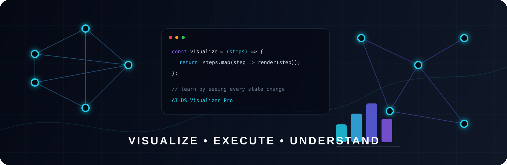
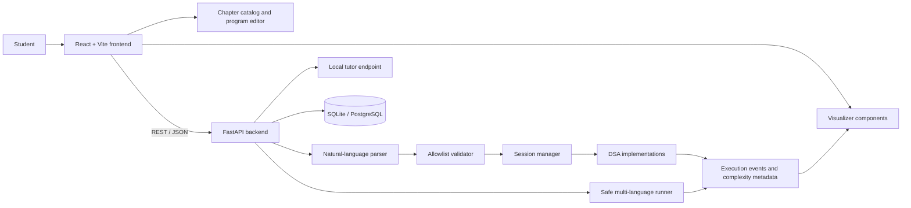
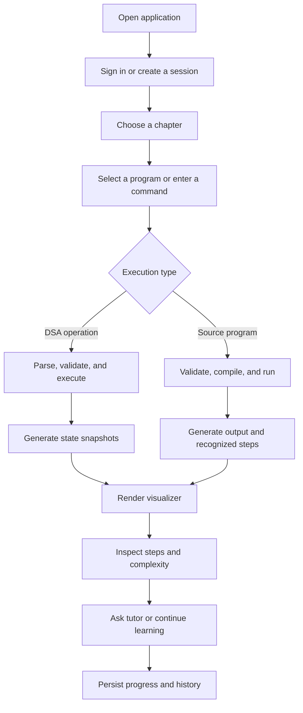

<!-- AI-DS Visualizer Pro | Premium project documentation -->

<div align="center">



# AI-DS Visualizer Pro

### Learn Data Structures Visually. Execute Algorithms Safely. Understand Every Step.


<br />

[](https://ai-ds-visualizer-pro.vercel.app/)
[](https://github.com/SairajAgawane/AI--DS-Visualizer-Pro)
[](frontend/)
[](backend/)

</div>
## ✦ Project introduction

AI-DS Visualizer Pro is an interactive Data Structures and Algorithms learning platform that connects code, execution events, visual state, complexity metadata, and learning progress in one focused workspace.

Instead of reading an algorithm in isolation, learners can select a topic, execute operations, move through the resulting steps, inspect state transitions, and ask the in-app tutor for an explanation of the current concept.

## ◈ The problem

DSA concepts are often taught as static code listings or textbook diagrams. That makes it difficult to understand:

- how a data structure changes after each operation;
- why an algorithm takes a particular path;
- how time and space complexity relate to execution; and
- how source code maps to the state visible on screen.

## ◇ The solution

1. Choose a DSA chapter or program.
2. Enter a natural-language command or open an educational program.
3. Execute the operation or program through the backend.
4. Inspect state snapshots, execution steps, and complexity metadata.
5. Navigate the visualization and use the tutor to clarify the concept.
6. Track learning progress, history, streaks, and completed programs.

## ⚡ Key features

| Capability | What it provides |
| --- | --- |
| Interactive visualizers | Animated views for arrays, stacks, queues, lists, trees, heaps, graphs, and algorithms. |
| Step-by-step execution | State snapshots, event steps, navigation controls, and operation explanations. |
| Educational code runner | Python, C, C++, and Java execution with validation, timeouts, output limits, and diagnostics. |
| Natural-language commands | Safe parsing and validation for supported data-structure operations. |
| AI-assisted tutor | Context-aware local explanations based on the current topic and visible state. |
| Learning dashboard | Progress, chapters, programs, streaks, recent activity, and recommended topics. |
| Authentication and roles | User routes, protected pages, role-aware admin access, and login activity tracking. |
| Admin insights | User, activity, and platform telemetry endpoints for administrators. |
| Persistent history | SQLite locally, with PostgreSQL-compatible configuration for hosted environments. |

## 🧩 Interactive DSA modules

The frontend program catalog contains 14 chapters and 80 learning programs.

| Module | Verified learning operations |
| --- | --- |
| Array | Create, traverse, insert, delete, update, search |
| Stack | Push, pop, peek, display, array and linked-list implementations |
| Queue | Enqueue, dequeue, front, rear, display |
| Circular Queue | Enqueue, dequeue, front, rear, circular wrap-around |
| Linked List | Create, insert at beginning/end/position, delete, search, traverse |
| Doubly Linked List | Insert, delete, forward/backward traversal, search |
| Binary Tree | Create, insert, inorder, preorder, postorder, level-order traversal |
| Binary Search Tree | Insert, search, delete, inorder, preorder, postorder |
| Heap | Create, insert, heapify, extract min/max, heap sort |
| Graph | Create, add vertex/edge, BFS, DFS, display graph |
| Hash Table | Create, insert, search, delete, collision handling |
| Recursion | Factorial, Fibonacci, recursive sum, recursive binary search |

### Sorting algorithms

- Bubble Sort — `O(n²)`
- Selection Sort — available in the frontend learning catalog
- Insertion Sort — `O(n²)`
- Merge Sort — `O(n log n)` with `O(n)` auxiliary space
- Quick Sort — `O(n log n)` as reported by the backend implementation

### Searching and graph algorithms

- Linear Search — `O(n)` time and `O(1)` space
- Binary Search — `O(log n)` time and `O(1)` space
- Breadth-First Search — `O(V + E)` time and `O(V)` space
- Depth-First Search — `O(V + E)` time and `O(V)` space
- Dijkstra’s Algorithm — `O((V + E) log V)` time and `O(V)` space

## ✨ AI-powered learning

The project includes an AI-oriented parsing and tutoring boundary:

```text
Natural-language command
          ↓
Local parser and operation schema
          ↓
Allowlist validation
          ↓
Session manager and DSA engine
          ↓
State snapshots, explanations, and visualization events
```

The current `/api/chat/` endpoint uses a deterministic local tutor provider. It answers supported questions about stacks, queues, linked lists, BSTs, heaps, and graphs using the current context. Provider configuration fields and the `google-genai` dependency are present for optional provider work, but the current chat response identifies itself as `provider: "local"`.

## 🏗️ System architecture



### Safety boundary

The backend does not use `exec` or `eval` for visualization. Program execution is isolated in temporary directories and uses a five-second timeout, bounded output, a restricted process environment, blocked system/network/filesystem patterns, and toolchain checks.

## 🔁 Application workflow



## 🧰 Technology stack


## 🖼️ Application showcase

### Playground


### Authentication experience


The original project banner is available at [`frontend/public/ai-ds-visualizer-banner.svg`](frontend/public/ai-ds-visualizer-banner.svg).

## 📁 Project structure

```text
.
├── backend/
│   ├── app/
│   │   ├── ai/                 # Parser, schemas, validator, session manager
│   │   ├── algorithms/         # Search, sorting, and graph algorithms
│   │   ├── api/                # FastAPI routers and API contracts
│   │   ├── data_structures/    # Core DSA implementations
│   │   └── models/             # SQLAlchemy persistence models
│   ├── tests/                  # Backend tests
│   └── requirements.txt
├── frontend/
│   ├── src/
│   │   ├── components/         # Navbar, copilot, shared UI
│   │   ├── data/               # DSA and algorithm program definitions
│   │   ├── pages/              # Landing, dashboard, learn, progress, admin
│   │   ├── visualizers/        # Interactive visualizer components
│   │   └── ui-kit/             # Reusable UI primitives
│   ├── public/                 # Screenshots, icons, and banner assets
│   └── package.json
├── docs/                       # Architecture and API notes
├── package.json                # Root npm workspace scripts
├── run.bat                    # Windows helper script
├── vercel.json                # Deployment configuration
└── README.md
```

## 🚀 Installation guide

### Prerequisites

- Node.js and npm
- Python 3.10 or newer recommended
- `gcc` for C programs
- `g++` for C++ programs
- JDK (`javac` and `java`) for Java programs
- Optional PostgreSQL/Supabase database for hosted persistence

### Clone and install

```bash
git clone https://github.com/SairajAgawane/AI--DS-Visualizer-Pro.git
cd AI--DS-Visualizer-Pro
npm install
```

The root package uses npm workspaces and installs the frontend dependencies.

### Configure the backend

```bash
cp backend/.env.example backend/.env
```

Windows PowerShell:

```powershell
Copy-Item backend/.env.example backend/.env
```

Create and activate a virtual environment:

```bash
python -m venv .venv

# macOS/Linux
source .venv/bin/activate

# Windows PowerShell
.venv\Scripts\Activate.ps1

pip install -r backend/requirements.txt
```

### Configure the frontend

```bash
cp frontend/.env.example frontend/.env
```

Windows PowerShell:

```powershell
Copy-Item frontend/.env.example frontend/.env
```

The local frontend defaults to `VITE_API_URL=http://localhost:8000`.

## 💻 Local development

Start the backend from the repository root:

```bash
uvicorn app.main:app --reload --app-dir backend
```

Start the frontend in a second terminal:

```bash
npm run dev
```

| Service | URL |
| --- | --- |
| Frontend | `http://localhost:5173` |
| Backend | `http://localhost:8000` |
| API health | `http://localhost:8000/api/health` |

## 🔐 Environment configuration

### Frontend variables

| Variable | Purpose | Local value |
| --- | --- | --- |
| `VITE_API_URL` | Backend API base URL | `http://localhost:8000` |
| `VITE_GOOGLE_CLIENT_ID` | Optional Google OAuth web client ID | Empty |

### Backend variables

| Variable | Purpose | Local value |
| --- | --- | --- |
| `AI_PROVIDER` | Tutor/provider selection | `local` |
| `AI_API_KEY` | Optional provider API key | Empty |
| `AI_MODEL` | Optional provider model | Empty |
| `CORS_ORIGINS` | Allowed comma-separated origins | `http://localhost:5173` |
| `AUTH_SECRET` | Authentication signing secret | Replace for deployment |
| `GOOGLE_CLIENT_ID` | Optional backend Google client ID | Empty |
| `DATABASE_URL` | SQLAlchemy database URL | `sqlite:///./sql_app.db` |

Never commit `.env` files, API keys, database credentials, OAuth secrets, or authentication secrets.

## 📦 Scripts and verification

| Command | Purpose |
| --- | --- |
| `npm run dev` | Start the Vite development server |
| `npm run build` | Type-check and build the frontend |
| `npm run preview` | Preview the frontend production build |
| `npm run lint` | Run Oxlint |

Backend tests:

```powershell
$env:PYTHONPATH = "backend"
pytest backend/tests
```

```bash
PYTHONPATH=backend pytest backend/tests
```

## 🔌 API integration

| Endpoint | Purpose |
| --- | --- |
| `POST /api/ai/parse` | Parse and validate natural-language commands |
| `POST /api/execute/` | Execute validated DSA operations |
| `POST /api/chat/` | Return context-aware tutor guidance |
| `POST /api/algorithm/run` | Run search, sorting, or graph algorithms |
| `POST /api/code/analyze` | Recognize supported visualization patterns |
| `POST /api/code/generate` | Generate educational source code |
| `POST /api/program/run` | Run Python, C, C++, or Java programs |
| `GET /api/history` | Retrieve operation history |
| `GET /api/progress` | Retrieve authenticated progress |
| `GET /api/achievements` | Retrieve achievements |
| `GET /api/health` | Check backend and database health |

See [docs/api.md](docs/api.md) for examples and [docs/architecture.md](docs/architecture.md) for the runtime pipeline.

## ☁️ Production build and Vercel deployment

Build the frontend locally:

```bash
npm run build
npm run preview
```

For Vercel deployment:

1. Import the repository into Vercel.
2. Use the existing `vercel.json` configuration.
3. Configure `VITE_API_URL` to point to the deployed backend.
4. Configure backend secrets and database settings through the deployment environment.
5. Confirm the deployed frontend can reach `/api/health`.

The project includes `frontend/vercel.json` and root-level `vercel.json` deployment configuration.

## 🛡️ Security considerations

- User programs are checked for restricted system, process, network, and filesystem operations.
- Execution is bounded by timeout and output limits.
- Only a restricted set of environment variables is passed to child processes.
- The visualizer does not execute arbitrary user code through Python `exec` or `eval`.
- Production deployments must replace development secrets and default credentials.
- CORS origins should be narrowed to trusted deployment domains.
- Public program execution should use suitable process isolation and resource limits.

## 🗺️ Future enhancements

- Connect optional AI provider configuration to a production tutor provider.
- Expand visualization coverage for additional structures and operations.
- Add richer challenge and assessment flows.
- Improve automated frontend coverage.
- Add accessibility audits and keyboard-first navigation.
- Strengthen production isolation for multi-language program execution.

## 🤝 Contributing

1. Fork the repository.
2. Create a focused branch for your feature or fix.
3. Install frontend and backend dependencies.
4. Run lint, build, and backend tests.
5. Update documentation when behavior or API contracts change.
6. Open a pull request with a clear summary and verification notes.

Please do not commit secrets, local databases, generated build output, or unrelated changes.

## 📜 License

No `LICENSE` file is currently included in the repository. Add a license before distributing the project or accepting external contributions.

## 👨‍💻 Developer

<div align="center">

### Sairaj Vilas Agawane

[](https://github.com/SairajAgawane)

</div>

## 🔗 Project links

- **Repository:** [github.com/SairajAgawane/AI--DS-Visualizer-Pro](https://github.com/SairajAgawane/AI--DS-Visualizer-Pro)
- **Live demo:** [ai-ds-visualizer-pro.vercel.app](https://ai-ds-visualizer-pro.vercel.app/)
- **Architecture notes:** [docs/architecture.md](docs/architecture.md)
- **API reference:** [docs/api.md](docs/api.md)

<div align="center">

### Visualize the structure. Trace the algorithm. Master the concept.

<sub>Built for learners who want to understand what the code is doing—not just memorize the output.</sub>

</div>

