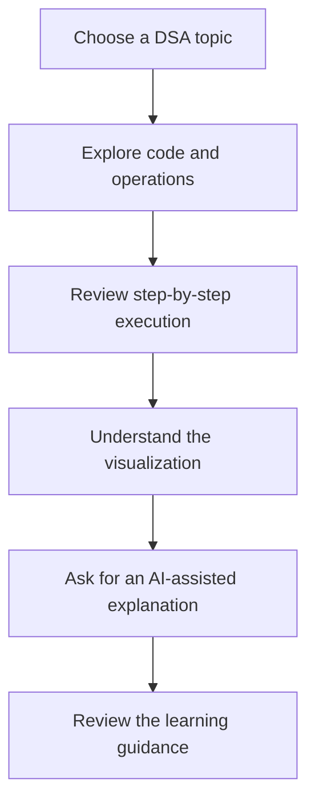

# AI-DS Visualizer Pro

AI-DS Visualizer Pro is an AI-assisted learning platform designed to make Data Structures and Algorithms easier to understand through interactive visualizations, step-by-step execution, and contextual explanations.

[](https://ai-ds-visualizer-pro.vercel.app/)
[](https://github.com/SairajAgawane/AI--DS-Visualizer-Pro)
[](https://github.com/SairajAgawane/AI--DS-Visualizer-Pro)

## Overview

Learning Data Structures and Algorithms can be difficult when code, execution flow, and theory are presented separately. AI-DS Visualizer Pro is intended to bring these concepts together in one focused learning experience.

The platform is designed to help learners:

- understand how algorithms execute step by step;
- connect source code with visual changes in data structures;
- explore concepts through interactive learning experiences; and
- use AI-assisted explanations to clarify difficult topics.

## Core objectives

- Make DSA concepts more visual and approachable.
- Help beginners understand algorithm execution instead of memorizing code.
- Provide explanations that are connected to the learner’s current topic.
- Create a practical environment for experimenting with algorithms.

## Planned capabilities

The project vision includes the following capabilities:

| Capability | Purpose |
| --- | --- |
| Interactive visualization | Show how data structures and algorithms change during execution. |
| Step-by-step learning | Break complex operations into understandable execution steps. |
| Code-focused exploration | Connect algorithm behavior with the code being studied. |
| AI-assisted explanations | Use Google Gemini to provide additional explanations and learning support. |
| Beginner-friendly interface | Make DSA concepts easier to explore and revisit. |

> Note: The repository currently has no committed application source files. The capabilities above describe the project scope supplied by the maintainer and should be verified against the implementation as the application is committed.

## Learning workflow



This diagram represents the intended learning experience. The final workflow should be updated when the application implementation is available.

## Technology stack

The project is intended to use modern web technologies and Google Gemini-based AI assistance. The exact framework, libraries, scripts, and API configuration are not yet verifiable because the repository currently contains no `package.json` or source tree.

When implementation files are available, this section should list only technologies confirmed by the codebase, such as:

- frontend framework;
- programming language;
- styling and UI libraries;
- visualization libraries;
- AI SDK or API client;
- testing tools; and
- deployment configuration.

## Getting started

### Prerequisites

The required runtime and package-manager versions will be documented after the project manifest is added.

### Installation

```bash
git clone https://github.com/SairajAgawane/AI--DS-Visualizer-Pro.git
cd AI--DS-Visualizer-Pro
```

The dependency-installation command will be added after the project’s package manifest is committed.

### Environment variables

The application is expected to require configuration for AI functionality. The exact environment-variable names must be taken from the implementation and should never be guessed or documented with real credentials.

Use a local environment file for development and configure deployment secrets through the hosting provider. Never commit API keys, tokens, or private credentials.

### Run locally

Development and production commands will be documented here once they are defined in the project configuration.

## Deployment

The project information supplied by the maintainer lists Vercel as the deployment platform.

Live project: [ai-ds-visualizer-pro.vercel.app](https://ai-ds-visualizer-pro.vercel.app/)

The deployment URL and its relationship to the committed source should be verified when the application code is available.

## Repository structure

The repository does not currently contain a committed application structure. After the source is added, this section should describe the actual directories and their responsibilities, for example:

```text
project-root/
├── src/                 # Application source
├── public/              # Static assets
├── package.json         # Dependencies and scripts
└── README.md            # Project documentation
```

The example above is illustrative only and must be replaced with the real project tree.

## Security considerations

- Keep Gemini or other API credentials outside the repository.
- Use environment variables or managed deployment secrets.
- Do not expose private keys in client-side code unless the architecture explicitly requires it and the exposure is understood.
- Validate user-provided code or input before executing or displaying it.
- Review third-party dependencies before introducing them into the project.

## Future enhancements

Potential future improvements include:

- expanding DSA coverage;
- adding more execution visualizations;
- supporting multiple programming languages;
- adding progress tracking and practice exercises;
- improving accessibility and keyboard navigation;
- adding automated tests; and
- providing richer AI explanations and examples.

These are future possibilities, not currently verified features.

## Contributing

Contributions are welcome once the implementation and contribution workflow are established.

1. Fork the repository.
2. Create a focused branch for your change.
3. Make the change and add appropriate tests where applicable.
4. Update documentation when behavior changes.
5. Open a pull request with a clear explanation of the change.

Please avoid committing secrets, generated build output, or unrelated changes.

## License

No `LICENSE` file is currently present in the repository. Add a license before distributing the project or accepting external contributions.

## Developer

**Sairaj Vilas Agawane**

- GitHub: [SairajAgawane](https://github.com/SairajAgawane)
- Repository: [AI--DS-Visualizer-Pro](https://github.com/SairajAgawane/AI--DS-Visualizer-Pro)
- Live project: [ai-ds-visualizer-pro.vercel.app](https://ai-ds-visualizer-pro.vercel.app/)

## Current repository note

This README is prepared for the project’s GitHub repository using the project information supplied by the maintainer. The public repository currently has no committed source files, dependencies, screenshots, tests, or license, so implementation-specific claims should be updated after the application code is pushed.
